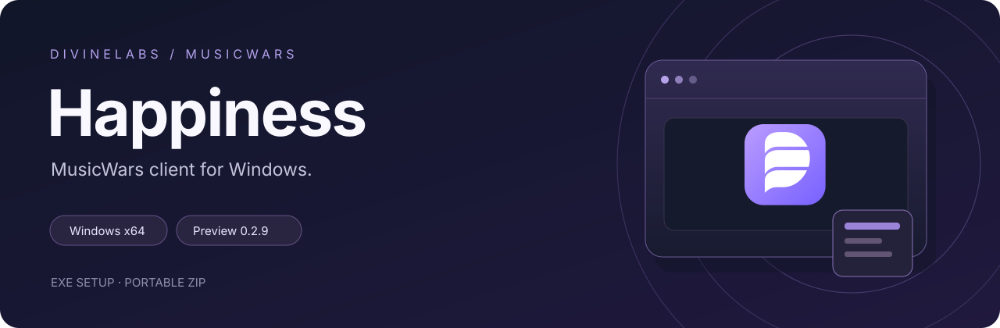

[Русский](README.md) · **English**

# DivineLabs Happiness

MusicWars client for Windows. Available as an installer and a portable archive.

**[Download](#download)** · **[News](NEWS.en.md)** · **[Getting started](docs/en/getting-started.md)** · **[Support](#support)**

## Download

| Variant | Installer | Portable | VK sign-in |
| --- | --- | --- | --- |
| With bundled WebView2 | [EXE](https://github.com/TheDivineLabs/DivineLabs_Happiness_Releases/releases/download/v0.2.10/DivineLabs.Happiness.Client.Setup.exe) | [ZIP](https://github.com/TheDivineLabs/DivineLabs_Happiness_Releases/releases/download/v0.2.10/DivineLabs-Happiness-Client-portable.zip) | Runtime included |
| Without bundled WebView2 | [EXE](https://github.com/TheDivineLabs/DivineLabs_Happiness_Releases/releases/download/v0.2.10/DivineLabs.Happiness.Client.SystemWebView2.Setup.exe) | [ZIP](https://github.com/TheDivineLabs/DivineLabs_Happiness_Releases/releases/download/v0.2.10/DivineLabs-Happiness-Client-SystemWebView2-portable.zip) | Installed system WebView2 Runtime required |

Version: **v0.2.10**. [Release notes and checksums](https://github.com/TheDivineLabs/DivineLabs_Happiness_Releases/releases/tag/v0.2.10). Both variants include CEF and Flash for the game.

Preview release. Full gameplay testing is still in progress.

## Features

- Resizable game window, fullscreen mode and keyboard shortcuts.
- A side panel opened with the movable DivineLabs logo.
- Four themes: Orbit, Signal, Paper and Control.
- Game screenshots without the client's overlay controls.
- Minimize to the system tray.
- Local recording of technical performance data.
- Open email links inside the client.

## Client and Plus

Client is a standalone game client. Plus includes additional gameplay modules and has not been published. Subscriptions are not available yet.

## Performance

The main EXE of prepared version 0.2.10 is **4.17 MiB**. Browser components are included separately in the installer and portable archive.

Comparative FPS, CPU and memory benchmarks have not been published. [File sizes and measurements](docs/en/performance.md).

## Recent updates

- **2026-10-31 · 0.2.10** - [Two Client variants: with and without WebView2](news/en/0.2.10.md)

- **2026-10-30 · 0.2.9** - [Bundled VK sign-in component](news/en/0.2.9.md)

- **2026-10-30 · 0.2.8** - [Installer fixes, branding and project license](news/en/0.2.8.md)

[All news](NEWS.en.md)

## Support

**[DivineLabs Discord](https://discord.gg/vF47ExMQpn)** · **[Author on Telegram](https://t.me/ps1xo_on1ks)** · **[GitHub](https://github.com/TheDivineLabs)**

[Report an issue](https://github.com/TheDivineLabs/DivineLabs_Happiness_Releases/issues/new/choose) with your app version, Windows version and steps to reproduce it. Reports in Russian or English are welcome.

## License

Happiness uses [proprietary terms](LICENSE). Personal use and testing of official builds are permitted. Redistribution and resale of original project materials require the rights holder's permission. [English summary](docs/en/license.md).

This repository contains product documentation, news and releases. Application source code is not published here.

Independent, unofficial project. MusicWars and game assets belong to their respective rights holders.
