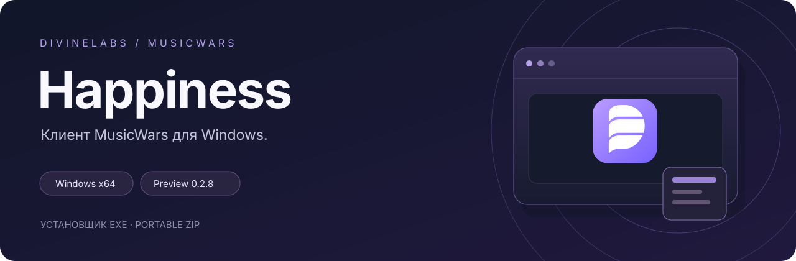

**Русский** · [English](README.en.md)

  

# DivineLabs Happiness

Клиент MusicWars для Windows. Доступен в виде установщика и portable-архива.

**[Скачать](#скачать)** · **[Что нового](NEWS.md)** · **[Начало работы](docs/getting-started.md)** · **[Поддержка](#поддержка)**

## Скачать

| Вариант | Установщик | Portable | Вход через ВК |
| --- | --- | --- | --- |
| Со встроенным WebView2 | [EXE](https://github.com/TheDivineLabs/DivineLabs_Happiness_Releases/releases/download/v0.2.11/DivineLabs.Happiness.Client.Setup.exe) | [ZIP](https://github.com/TheDivineLabs/DivineLabs_Happiness_Releases/releases/download/v0.2.11/DivineLabs-Happiness-Client-portable.zip) | Компонент включён |
| Без встроенного WebView2 | [EXE](https://github.com/TheDivineLabs/DivineLabs_Happiness_Releases/releases/download/v0.2.11/DivineLabs.Happiness.Client.SystemWebView2.Setup.exe) | [ZIP](https://github.com/TheDivineLabs/DivineLabs_Happiness_Releases/releases/download/v0.2.11/DivineLabs-Happiness-Client-SystemWebView2-portable.zip) | Нужен системный WebView2 Runtime |

Версия: **v0.2.11**. [Изменения и контрольные суммы](https://github.com/TheDivineLabs/DivineLabs_Happiness_Releases/releases/tag/v0.2.11). CEF и Flash для игры есть в обоих вариантах.

Предварительная версия. Полная игровая проверка ещё не завершена.

## Возможности

- Адаптивное окно игры, полноэкранный режим и горячие клавиши.
- Боковая панель по нажатию на перемещаемый логотип DivineLabs.
- Четыре темы: Orbit, Signal, Paper и Control.
- Скриншоты игры без элементов оболочки.
- Сворачивание в системный трей.
- Локальная запись технических показателей.
- Открытие ссылок из писем внутри клиента.

## Client и Plus

| | Client | Plus |
| --- | --- | --- |
| Игровое окно, темы, ссылки и скриншоты | Есть | Есть |
| Основное приложение | Самостоятельный клиент | Клиент с дополнительными игровыми модулями |
| Основной EXE · 0.2.8 | 4.16 МиБ | 15.80 МиБ |
| Публичный канал | Доступен | После запуска подписок |

Plus пока не опубликован. Подписки ещё не запущены.

## Производительность

Основной EXE подготовленной версии 0.2.14 занимает **3.67 МиБ**. Компоненты браузера входят в установщик и portable отдельно от EXE.

Сравнительных замеров FPS, CPU и памяти пока нет. [Сведения о размерах и замерах](docs/performance.md).

## Сейчас в проекте

- **2026-11-05 · 0.2.14** - [Client 0.2.14: обновление приложения и восстановление после сбоев](news/2026-11-05-client-0.2.14.md)

- **2026-11-04 · 0.2.13-dev** - [Единый мастер обслуживания](news/2026-11-04-maintenance-hub.md)

- **2026-11-04 · 0.2.12-dev** - [Восстановление запуска и обновления из приложения](news/2026-11-04-recovery-updates.md)

[Все новости →](NEWS.md)

## Поддержка

**[Discord DivineLabs](https://discord.gg/vF47ExMQpn)** · **[Автор в Telegram](https://t.me/ps1xo_on1ks)** · **[GitHub автора](https://github.com/TheDivineLabs)**

Нашли ошибку? [Откройте обращение](https://github.com/TheDivineLabs/DivineLabs_Happiness_Releases/issues/new/choose): укажите версию, Windows и шаги повторения.

## Лицензия и происхождение

Happiness распространяется на [закрытых условиях](LICENSE). Разрешено личное использование официальной сборки и тестирование. Публикация, перепродажа и распространение собственного кода и сборок требуют разрешения правообладателя. [Краткое объяснение](docs/license.md).

Этот репозиторий содержит страницу продукта, новости и материалы выпусков. Исходный код приложения здесь не публикуется.

Независимый неофициальный проект. MusicWars и игровые материалы принадлежат их правообладателям.
